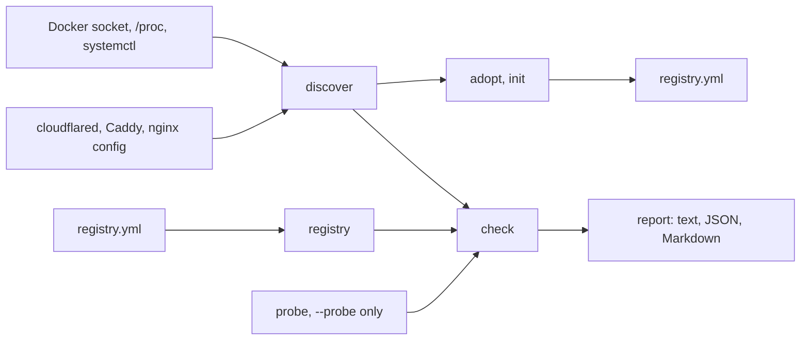

# unlisted: how it is built

One static Go binary with a single dependency (`gopkg.in/yaml.v3`), built with `CGO_ENABLED=0`. It reads a YAML registry of what you say you run, reads what the machine exposes through six sources, and a pure function turns the difference into findings that three writers print. <!-- src: go.mod, Makefile:1-9 -->

## Components

- `main.go` only calls `cli.Run` and exits with its code. <!-- src: main.go:10-12 -->
- `internal/cli` parses flags and dispatches `check` (the default), `init`, `demo`, `version` and `help`; `Run` returns an exit code instead of exiting so every path is testable. <!-- src: internal/cli/cli.go:1-2, internal/cli/cli.go:68-89 -->
- `internal/registry` loads the registry with strict validation: unknown fields, a missing name, a bad `auth` value, a duplicate host or a service with none of `host`, `port`, `url` are errors with line numbers, all collected in one pass. <!-- src: internal/registry/registry.go:62-65, internal/registry/registry.go:103-160 -->
- `internal/discover` holds one file per source behind a two-method `Source` interface: `cloudflared`, `caddy`, `nginx`, `docker`, `proc` and `systemd`. A source that is absent or fails becomes a status line and never stops the run. <!-- src: internal/discover/types.go:64-67, internal/discover/types.go:97-99, internal/discover/types.go:103-154 -->
- `internal/discover/origin.go` parses the spellings proxies use for a backend (`http://localhost:8080`, `:8080`, `[::1]:3000`, `unix:/run/x.sock`, `bastion`); sockets and `bastion` carry no port. <!-- src: internal/discover/origin.go:39-42, internal/discover/origin.go:20-37 -->
- `internal/check` merges hostnames from all sources into sites, then produces `UNREGISTERED`, `DEAD`, `NOAUTH`, `DRIFT` and `CERT` findings, sorted by type, then severity. It does no I/O. <!-- src: internal/check/check.go:43-61, internal/check/check.go:499-518, internal/check/types.go:9-16 -->
- `internal/probe` is the only network code: with `--probe` it sends an HTTPS `HEAD` (falling back to `GET` when HEAD gets 405 or 501) to registry hostnames, up to 8 at a time, with a 5 second default timeout, and reads status and TLS expiry. <!-- src: internal/probe/probe.go:1-4, internal/probe/probe.go:47-56, internal/probe/probe.go:110-114 -->
- `internal/report` writes the text, JSON (schema `unlisted/v1`) and Markdown reports; colour follows `--no-color`, `NO_COLOR`, `CLICOLOR_FORCE`, `TERM=dumb`, then whether stdout is a terminal. <!-- src: internal/report/json.go:12-14, internal/report/markdown.go:12, internal/report/text.go:17, internal/report/style.go:12-30 -->
- `internal/adopt` builds the starter registry for `unlisted init` from a discovery snapshot. <!-- src: internal/adopt/adopt.go:1-4, internal/adopt/adopt.go:43 -->
- `demo/` is a fake homelab in the `--config-root` layout, embedded in the binary; `internal/kit` holds tests only, no product code. <!-- src: demo/demo.go:1-10, internal/kit/kit_test.go:1-4 -->
- `scripts/` holds two dev-only Python helpers: one regenerates the fake `/proc` and Docker fixtures, one renders the demo output to a PNG. <!-- src: scripts/gen-demo-fixture.py:1-10, scripts/render-demo.py:1-10 -->

## Data flow

- `check` loads the registry, runs every source into one snapshot, optionally probes registry hostnames, builds the report, then writes it in the chosen format and exits 0, 1 or 2. <!-- src: internal/cli/cli.go:163-234 -->
- With no registry file and no `-f`, `check` runs against an empty registry and flags the report as having none; an explicit `-f` that does not exist is exit 2. <!-- src: internal/cli/cli.go:188-203 -->
- Discovery merges listeners by port and reachability, so one port bound on `0.0.0.0` and `::`, or seen by both `/proc` and Docker, is one row. <!-- src: internal/discover/types.go:156-191 -->
- The checker indexes sites and ports, then runs in order: unregistered hosts, registered services (dead, noauth, drift), unregistered ports, certs, and the dashboard-tunnel note. <!-- src: internal/check/check.go:43-61 -->
- Exit is 1 only when a finding's type is in `--fail-on`; `--fail-on none` always exits 0. <!-- src: internal/cli/cli.go:217-220, internal/check/types.go:82-96 -->
- `init` runs the same discovery, builds the YAML in `adopt`, and writes it (or prints it with `-o -`); an existing target needs `--force`. <!-- src: internal/cli/cli.go:250-282 -->
- `demo` unpacks the embedded fixtures into a temp directory, runs `check` against it with `--fail-on none` and removes the directory afterwards. <!-- src: internal/cli/cli.go:135-160 -->

## Storage

- No database, cache or state between runs. It reads config files, `/proc` and the Docker socket, and the only file it writes is the `unlisted init` output (default `registry.yml`). <!-- src: internal/cli/cli.go:254-273, SECURITY.md:11 -->
- `unlisted demo` writes a temp directory for the unpacked fixtures and removes it before returning. <!-- src: internal/cli/cli.go:136-140 -->
- Paths it reads by default: `/etc/cloudflared/config.yml` (and `.yaml`, and `~/.cloudflared/config.yml`), `/etc/caddy/Caddyfile`, `/etc/nginx`, `/var/run/docker.sock`, `/proc/net/tcp{,6}` and `/proc/*/fd`. `--config-root` or `UNLISTED_ROOT` resolves them under another directory. <!-- src: internal/discover/cloudflared.go:17-25, internal/discover/caddy.go:18, internal/discover/nginx.go:19, internal/discover/docker.go:51, internal/discover/proc.go:32-33, docs/reference.md:36-41 -->

## Auth

- None. It is a local command line tool with no server, accounts or tokens. <!-- src: main.go:10-12, internal/cli/cli.go:68-89 -->
- It reads whatever the running user can read. A Docker socket the user cannot open is reported as `permission denied (add the user to the docker group, or run as root)` and skipped. <!-- src: internal/discover/docker.go:56-57 -->
- "Auth" in its findings is about the services it checks: a registry `auth:` value of `none`, `proxy`, `app` or `cloudflare-access`, compared with auth directives seen in tunnel and proxy config (or, with `--probe`, in the response). <!-- src: internal/registry/registry.go:22-29, internal/probe/probe.go:145-162 -->

## External services

- The Docker Engine API over the local Unix socket (`GET /containers/json`, 3 second timeout), no network. <!-- src: internal/discover/docker.go:61-70 -->
- `systemctl list-units --type=service --state=running`, run with a 4 second timeout; skipped silently when `systemctl` is missing or fails. <!-- src: internal/discover/systemd.go:29-40 -->
- With `--probe` only, HTTPS to each concrete registry hostname (wildcards and `ignore: true` entries are skipped). Nothing else is contacted. <!-- src: internal/cli/cli.go:236-248, internal/probe/probe.go:1-4 -->
- Env vars it reads: `UNLISTED_ROOT` (same as `--config-root`), `NO_COLOR`, `CLICOLOR_FORCE`, `TERM`. No credentials. <!-- src: internal/cli/cli.go:107, internal/report/style.go:14-30 -->
- Outside the binary: the `release` workflow runs GoReleaser on a `v*` tag, and `install.sh` and `action.yml` download `unlisted_<os>_<arch>.tar.gz` and `checksums.txt` from the GitHub release and verify the checksum before unpacking. <!-- src: .github/workflows/release.yml:3-6, install.sh:34-47, action.yml:57-66 -->

## Unverified

- Rootless Docker and Podman socket paths: `docs/limitations.md` says they are not tested, and the default path is only `/var/run/docker.sock`.
